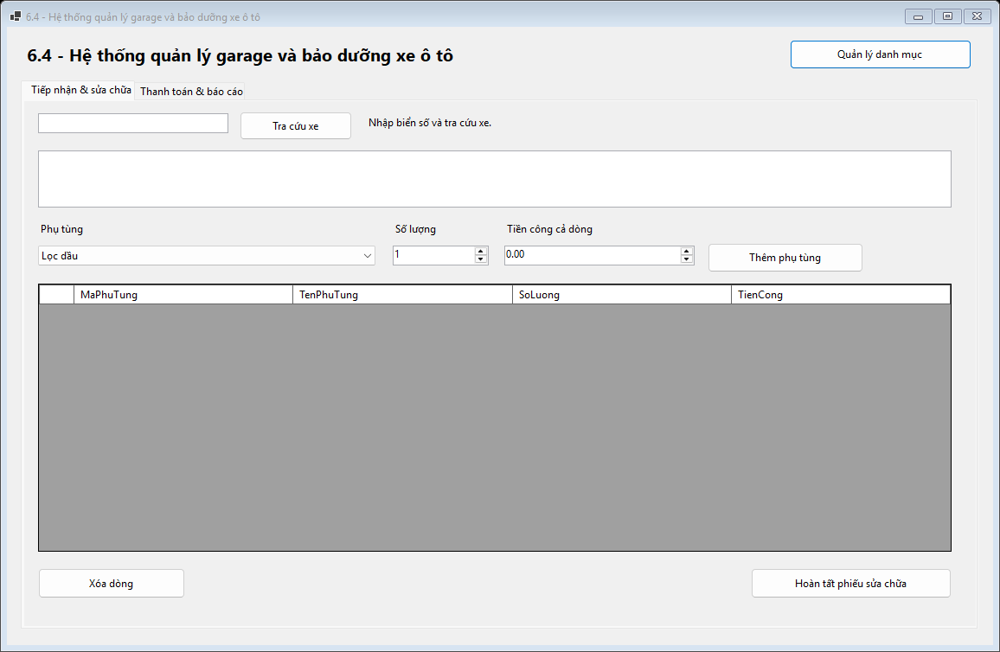
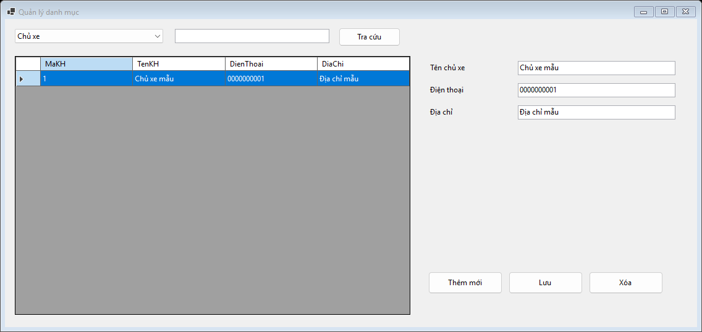
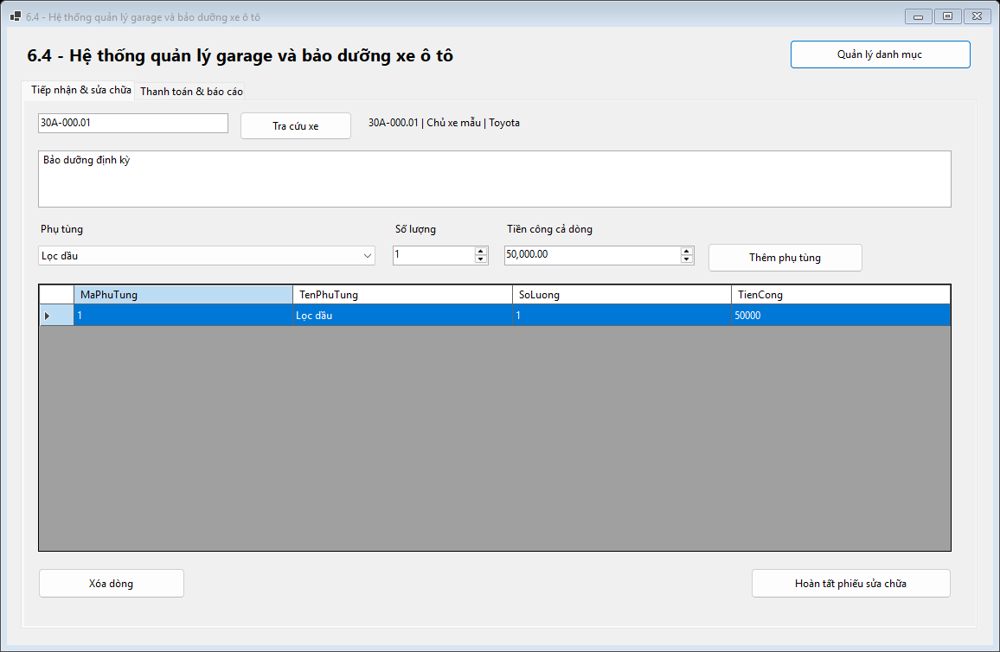
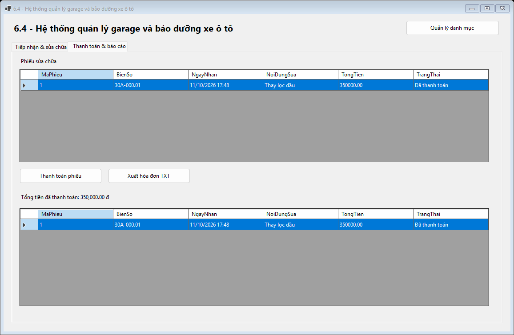
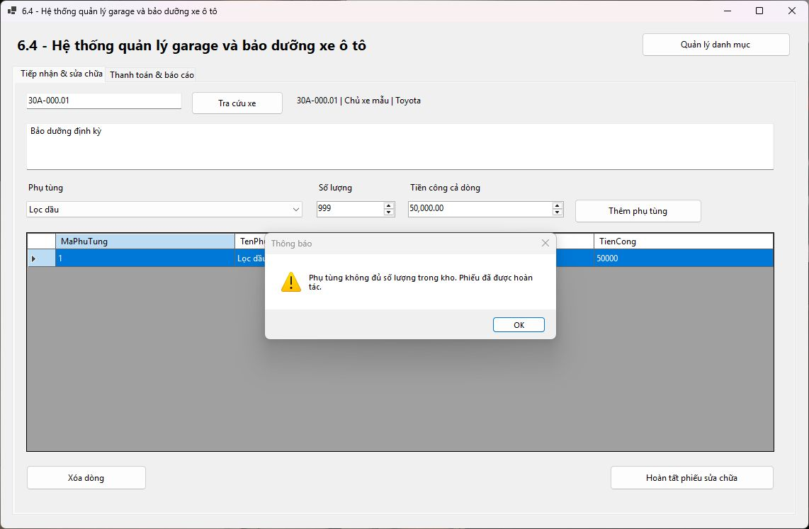

# Bài 6.4 - Hệ thống quản lý garage và bảo dưỡng xe ô tô

## Mục 1. Thông tin sinh viên

- Họ và tên sinh viên: Phạm Tuấn Thành
- Mã sinh viên: 24810320264
- Lớp / Khóa: D19QTANM1

### Quy tắc đã thống nhất

Mỗi dòng có một phụ tùng, số lượng và tiền công của cả dòng. Khi hoàn tất phiếu, ứng dụng dùng đơn giá lúc đó để tính tổng và lưu cùng giao dịch trừ tồn. Khi thanh toán, hóa đơn TXT dùng tổng đã lưu. Danh sách phiếu đã thanh toán và tổng tiền nằm ở tab báo cáo.

### Cách chạy

1. Chạy [Database/ScriptDB.sql](Database/ScriptDB.sql) trên SQL Server để tạo CSDL GarageDB và dữ liệu mẫu.
2. Mở [GarageManagement.sln](GarageManagement.sln) trong Visual Studio có workload .NET desktop development và SDK .NET 8.
3. Kiểm tra cấu hình trong [DatabaseHelper.cs](GarageManagement/DAL/DatabaseHelper.cs). Máy chủ mặc định là (localdb)\MSSQLLocalDB. Nếu dùng máy chủ khác, sửa chuỗi kết nối theo máy chủ đã chạy script.
4. Nhấn **F5**. Để mở Design View, chọn MainForm.cs hoặc CatalogForm.cs trong Solution Explorer và nhấn **Shift+F7**.

## Mục 2. Hình ảnh kết quả các màn hình chức năng

### 1. Tiếp nhận xe

### 2. Quản lý chủ xe, xe và phụ tùng

### 3. Lập phiếu sửa chữa

### 4. Phiếu đã thanh toán và tổng tiền

### 5. Hoàn tác phiếu khi thiếu phụ tùng

